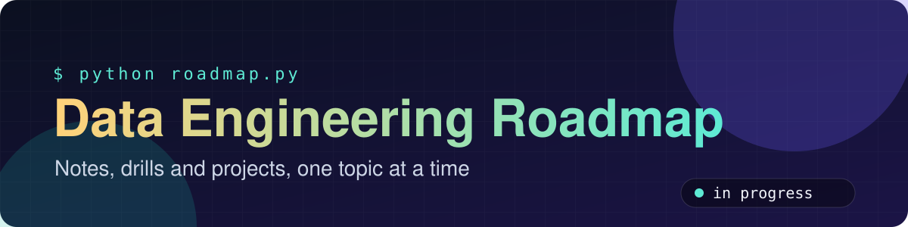
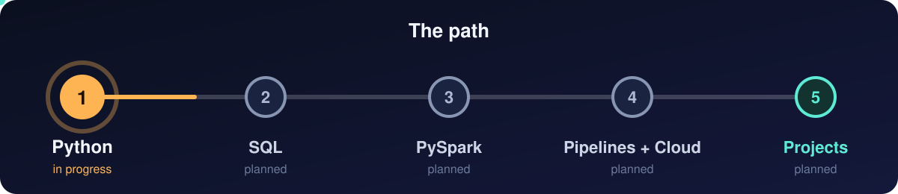

<p align="center"></p>

<p align="center">
  
  
  
  
  
</p>

<p align="center">
  Working notes, drills and projects while I build a strong foundation for data engineering:<br>
  clean Python, problem solving, and explaining my code clearly.
</p>

<p align="center"></p>

## Python progress

| # | Topic | Status |
|:-:|-------|:------:|
| 1 | Setup, print, variables, types, arithmetic | ✅ Done |
| 2 | Strings: indexing, slicing, methods, f-strings | ✅ Done |
| 3 | Booleans, if / elif / else | ✅ Done |
| 4 | Functions | ✅ Done |
| 5 | Loops: for, while, break, continue | ✅ Done |
| 6 | Lists | ✅ Done |
| 7 | Lists II: 2D lists, sorting, loop patterns | 🔄 In progress |

More topics follow: tuples, dictionaries, sets, comprehensions, `collections`, Big-O and hash-map patterns.

## SQL progress

| # | Topic | Status |
|:-:|-------|:------:|
| 1 | Query execution order, filtering, NULL logic | ✅ Done |
| 2 | Aggregation, GROUP BY, HAVING, conditional aggregation | 🔄 In progress |

More SQL topics follow: joins, window functions and query tuning.

## What's inside every topic

| | |
|---|---|
| 📝 **Notes as code** | Short files that show one idea at a time, with comments |
| 🧪 **Drills** | Small exercises tested with several values, including boundaries |
| 🛠️ **Mini project** | A small program per topic: a name cleaner, a receipt printer, a storage decision tree |

## How I work

1. **Plan first:** restate the problem, write examples, sketch the steps as comments.
2. **Test the edges:** boundaries and special cases, not just the happy path.
3. **Explain it aloud:** what it is, why I use it, one detail.
4. **Review and redo:** earlier topics return in later exercises.

## Run a file

```bash
python path/to/file.py
```

Requires Python 3.

## About me

Data engineer working with Microsoft Fabric using Python, PySpark and SQL.
Profile: [github.com/IqraBaluch](https://github.com/IqraBaluch)